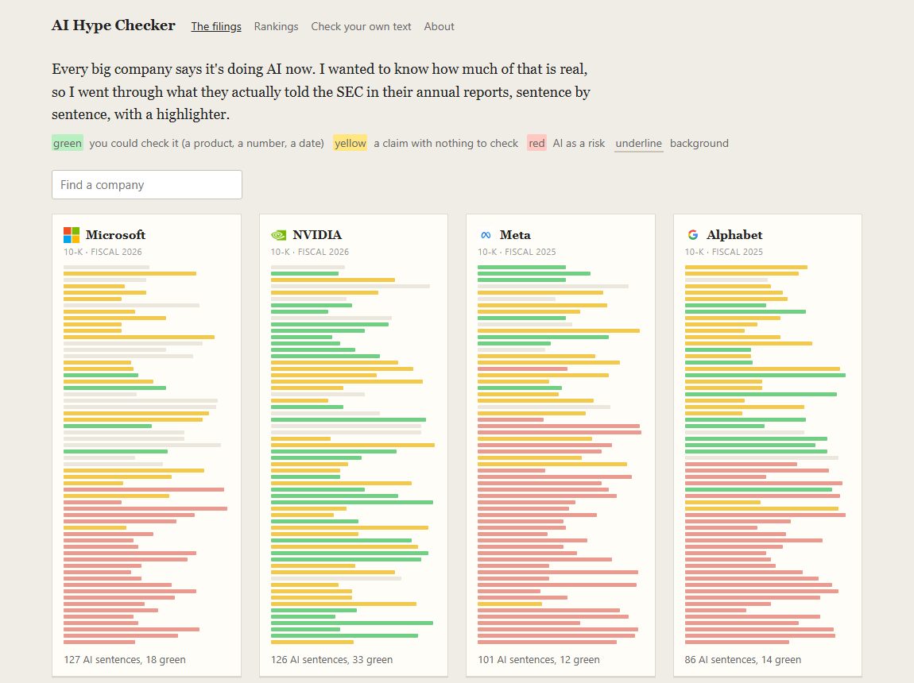

# AI-Washing Detector

Every company says "AI" now. This project reads every sentence about AI in the last two annual reports (10-Ks) of 15 large U.S. companies and sorts each one into a claim you can check, a claim you can't, a risk warning, or background. Then it scores each company on how much of its AI talk has substance.

**Live site: [tejesh18.github.io/ai-washing-detector](https://tejesh18.github.io/ai-washing-detector/)**: leaderboard, all 1,177 sentences, and a box where you can paste your own draft disclosure and see which sentences a reviewer would call vague.

[](https://tejesh18.github.io/ai-washing-detector/)

## Why I built this

I work on data systems at an institutional brokerage, and a lot of my day is spent around equity research. Over the last two years the word "AI" has spread through every annual report, and it's hard to tell which companies are describing real work and which are just using the word.

Regulators have noticed too. The SEC brought its first "AI-washing" cases in 2024 against two investment advisers that overstated their use of AI, and later charged a public company, Presto Automation. Most of the SEC's comment letters on AI disclosures ask companies for the same thing: be more specific. That's a measurable question, so I measured it.

## What I found

- **Apple went from 6 AI sentences to 47 in one year, and none of them is a checkable claim.** 39 of the 47 are risk warnings: lawsuits, regulation, safety, compute supply.
- **NVIDIA backs its AI talk up the most.** 38 concrete claims in its FY2025 10-K (named products, launch dates, a 2.5x throughput number) and the highest substance score in the set.
- **Tesla talks more and says less.** Its AI sentences more than doubled (20 to 47) while substance fell from 75% to 37%: vague claims went from 2 to 17.
- **The big banks don't hype AI at all.** JPMorgan and Goldman mention AI 20 to 28 times each, and every mention is a risk warning or background.
- **Across all 30 filings, only 15% of AI sentences are checkable.** Half are risk warnings.

## How it works

```
SEC EDGAR ──> parse 10-K HTML ──> find AI sentences ──> label 252 sentences ──> train classifiers
 (15 cos,      (sections, pages,     (1,177 sentences,      (4 labels, written      (5-fold CV,
  2 years)      tables, XBRL)         with section+page)     guideline)              4 methods)
                                                                                        │
                       static site <── company scores <── label every sentence <────────┘
                    (GitHub Pages)     (substance, mix,        (human labels kept
                                        year over year)         where they exist)
```

1. **Fetch.** Pulls the latest two 10-Ks per company from SEC EDGAR and caches them.
2. **Parse.** Splits each filing into blocks that know their page and 10-K section (Item 1 Business, Item 1A Risk Factors, Item 7 MD&A, ...).
3. **Extract.** Keeps every sentence that mentions AI. "AI" and "LLM" are matched case-sensitively so words like "said" never count.
4. **Label.** 252 sentences, sampled evenly across all 30 filings, labeled against [a written guide](labels/GUIDELINES.md).
5. **Classify.** Four approaches compared on the same cross-validation folds (below). The best one labels the remaining sentences.
6. **Score.** Substance = concrete / (concrete + vague). Risk warnings and background are left out on purpose, so a careful bank isn't punished for being careful.

### The four labels

| Label | Meaning | Example |
|---|---|---|
| concrete | A checkable claim about the company's own AI: a named product, a number, a dated launch | "NVIDIA NIM ... delivers a 2.5x increase in token throughput" |
| vague | A claim about the company's own AI with nothing to check | "We use, and expect to increasingly use, emerging technologies, including AI, across our operations" |
| risk | AI as a threat, uncertainty, cost or regulation | "The increasing sophistication of AI technologies poses a greater risk of identity fraud" |
| context | Laws, market, history, boilerplate | "In the EU, ... the AI Act ... [is] rapidly changing compliance requirements" |

## Results

252 labeled sentences, 5-fold stratified cross-validation, same folds for every method.

| Method | Macro F1 | Concrete | Vague | Risk | Context |
|---|---|---|---|---|---|
| Keyword rules | 0.61 | 0.59 | 0.52 | 0.92 | 0.42 |
| TF-IDF + logistic regression | **0.73** | 0.59 | 0.67 | **0.95** | **0.71** |
| bge-small embeddings + logistic regression | **0.73** | **0.69** | **0.68** | 0.92 | 0.62 |
| bge-small fine-tuned end to end | 0.70 | 0.68 | 0.60 | 0.91 | 0.61 |

- **Learning beats rules by 12 points**, almost all of it on the hard distinction: concrete vs vague.
- **Fine-tuning did not win.** With about 200 training sentences per fold, fine-tuning a 33M-parameter model overfits, and frozen embeddings with a linear classifier do better. More labels would probably change that; I'd rather report it than tune until the number looked better.
- **The embedding model labels the full set.** It ties TF-IDF overall but is clearly better on concrete and vague, the two labels the substance score depends on.
- **The draft checker on the site uses the TF-IDF model**, exported to JSON and reimplemented in JavaScript so it runs in the browser. It matches sklearn's predictions on all 252 labeled sentences.

## Things that were harder than expected

- **10-K HTML is not one format.** Amazon and Walmart put their "ITEM 1A. Risk Factors" headings inside one-row layout tables, so a parser that treats every table as data finds zero sections in their filings. Single-row short tables are now treated as text.
- **Banks file thousands of documents a year.** EDGAR's submissions API only returns about the last 1,000 filings, so JPMorgan's and Goldman's previous 10-K was missing until the parser followed the paged history files.
- **Tickers move.** The SEC's ticker file now maps XOM to a new Exxon holding company that hasn't filed a 10-K yet, so XOM is pinned to Exxon Mobil Corp's CIK.
- **Most AI talk isn't a claim.** My first labeling pass used only concrete vs vague and immediately broke: half the sentences are risk disclosures. Calling those "vague" would have made the careful companies look worst. That's why there are four labels and why substance ignores two of them.

## Limitations

- 15 companies and two years each. The leaderboard is a snapshot, not an index.
- The labels are a single pass with no second annotator, so there's no inter-annotator agreement number yet. The guideline is public so anyone can disagree with a specific call.
- Sentences are judged alone. A vague sentence followed by a concrete one in the next paragraph still counts as vague.
- Labels on the full set come from a model with about 0.7 F1 on the classes that matter, so treat company-level numbers as directional. Where a sentence is in the labeled set, its label is used (297 sentences, since some identical sentences appear in both years).
- Page numbers come from page breaks in the HTML, so they can be off by one from the PDF.

## Run it yourself

No API keys. Python 3.11+ and [uv](https://docs.astral.sh/uv/).

```bash
export SEC_USER_AGENT="Your Name you@example.com"   # the SEC asks every client for a contact

uv sync
uv run aiwash ingest       # download and parse 30 10-Ks (cached in data/)
uv run aiwash claims       # extract every AI sentence
uv run aiwash evaluate --methods rules,tfidf,embed    # add finetune with: uv sync --extra finetune
uv run aiwash score --method embed
uv run aiwash site         # writes docs/data.json and docs/model.json
uv run --group dev pytest
```

## Project layout

```
src/aiwash/
  edgar.py    SEC EDGAR client, caching, paged filing history
  parse.py    10-K HTML -> blocks with page and section
  claims.py   find AI sentences
  model.py    rules, TF-IDF, embeddings, fine-tuning; cross-validation
  embed.py    local bge-small embeddings (fastembed)
  cli.py      the aiwash command
labels/       hand labels and the labeling guide
results/      metrics, per-company scores, every scored sentence
docs/         the static site (GitHub Pages)
tests/
```

Data comes from SEC EDGAR. Nothing here is investment advice.
